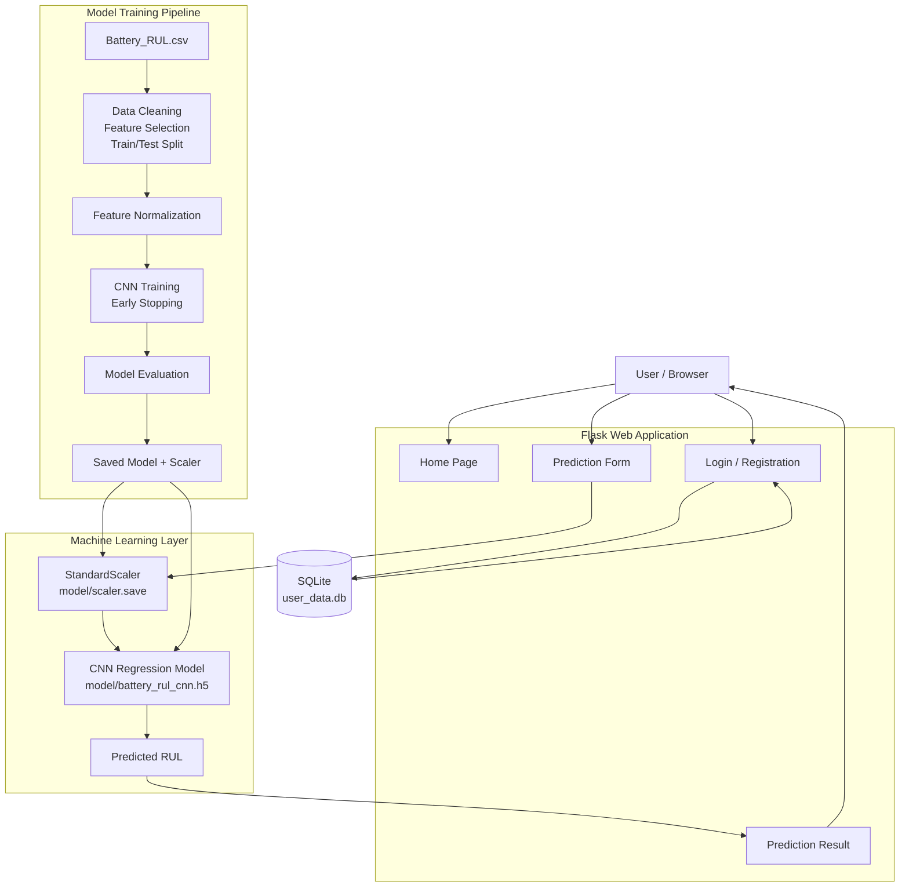

# Battery Remaining Useful Life (RUL) Prediction

## Project Overview

This project predicts the **Remaining Useful Life (RUL)** of a battery using machine learning and deep learning.

The application combines:

- **Flask** for the web application
- **SQLite** for user registration and login data
- **TensorFlow / Keras CNN** for RUL prediction
- **Scikit-learn StandardScaler** for feature normalization
- **Pandas / NumPy** for data processing
- **HTML/CSS templates** for the web interface
- A trained CNN model (`battery_rul_cnn.h5`)
- A saved preprocessing scaler (`scaler.save`)

The web application accepts battery operating parameters and returns a predicted RUL value.

---

# Architecture



## Architecture Flow

### Training Flow

1. `Battery_RUL.csv` is loaded.
2. Missing records are removed.
3. Eight battery features are selected.
4. The data is divided into training and testing sets.
5. `StandardScaler` normalizes the input features.
6. The normalized data is reshaped for a 1D CNN.
7. The CNN is trained using TensorFlow/Keras.
8. Early stopping is used during training.
9. The trained model is evaluated using MAE, MSE, RMSE, and R².
10. The trained model and scaler are saved for application use.

### Prediction Flow

1. The user opens the Flask web application.
2. The user registers or logs in.
3. The prediction page accepts eight battery parameters.
4. Flask receives the values.
5. The saved `StandardScaler` transforms the input.
6. The saved CNN model predicts the battery RUL.
7. The prediction result is displayed in the result page.

---

# Project Structure

```text
project/
│
├── app.py
├── main.py
├── main1.py
├── test.py
│
├── Battery_RUL.csv
├── testing_records.csv
├── training_records.csv
│
├── battery_rul_cnn.h5
├── battery_rul_rf.joblib
├── scaler.save
├── model_metrics.txt
├── training_history.png
├── actual_vs_predicted.png
│
├── model/
│   ├── main.py
│   ├── test.py
│   ├── battery_rul_cnn.h5
│   └── scaler.save
│
├── templates/
│   ├── home.html
│   ├── index.html
│   ├── aboutus.html
│   ├── logged.html
│   └── result.html
│
├── static/
│   └── p.jpg
│
├── BACKEND_CODE.ipynb
├── Untitled.ipynb
├── battery_rul_prediction_notebook.md
├── req.txt
└── user_data.db
```

---

# Requirements

Recommended environment:

- Python 3.9
- pip
- Windows, Linux, or macOS
- TensorFlow/Keras
- Flask
- NumPy
- Pandas
- Scikit-learn
- Joblib
- Matplotlib

> **Important:** The supplied `req.txt` contains older TensorFlow/Keras versions. For the most reliable execution of this existing project, use a Python 3.9 virtual environment rather than Python 3.14.

---

# Installation and Setup

## 1. Extract or Clone the Project

Open a terminal in the project directory.

```bash
cd project
```

If you received the ZIP file, extract it first and open the extracted folder.

---

## 2. Create a Virtual Environment

### Windows

```bash
py -3.9 -m venv venv
```

Activate it:

```bash
venv\Scripts\activate
```

### Linux / macOS

```bash
python3.9 -m venv venv
source venv/bin/activate
```

After activation, the terminal should show something similar to:

```text
(venv)
```

---

## 3. Upgrade pip

```bash
python -m pip install --upgrade pip
```

---

## 4. Install Dependencies

The project includes a dependency file named `req.txt`.

Run:

```bash
pip install -r req.txt
```

If the full notebook dependency list causes installation conflicts, install the core application dependencies first:

```bash
pip install Flask==3.1.0 numpy==1.23.5 pandas==2.2.3 scikit-learn==1.0.2 joblib==1.5.0 matplotlib==3.9.4 tensorflow==2.7.0
```

---

# Run the Existing Trained Application

The repository already contains the trained CNN model and scaler, so you do **not** need to retrain the model just to run the web application.

Make sure these files are available:

```text
model/battery_rul_cnn.h5
model/scaler.save
app.py
templates/
static/
user_data.db
```

Start Flask:

```bash
python app.py
```

You should see Flask start on a local address similar to:

```text
http://127.0.0.1:5000
```

Open the displayed address in your browser.

---

# Application Usage

## 1. Open Home Page

Open:

```text
http://127.0.0.1:5000/
```

The Flask application loads:

```text
templates/home.html
```

---

## 2. Register a User

Use the registration interface.

The application stores user information in:

```text
user_data.db
```

The database is SQLite.

---

## 3. Login

Use the login page with the registered credentials.

After successful login, the application opens the logged-in interface.

---

## 4. Enter Battery Parameters

The prediction form expects the following eight input values:

| # | Input | Description |
|---|---|---|
| 1 | Cycle Index | Battery cycle number |
| 2 | Discharge Time (s) | Battery discharge duration |
| 3 | Decrement 3.6-3.4V (s) | Time-related voltage decrement feature |
| 4 | Max. Voltage Dischar. (V) | Maximum discharge voltage |
| 5 | Min. Voltage Charg. (V) | Minimum charging voltage |
| 6 | Time at 4.15V (s) | Time spent at 4.15 V |
| 7 | Time constant current (s) | Constant-current charging duration |
| 8 | Charging time (s) | Total charging duration |

These values are passed to the model in this order.

---

## 5. Generate Prediction

Click the prediction/submit button.

The application:

```text
Input
  ↓
StandardScaler
  ↓
CNN Model
  ↓
Predicted RUL
  ↓
Result Page
```

The result is displayed by:

```text
templates/result.html
```

---

# Train the Model Again

If you want to retrain the CNN instead of using the supplied trained model, use:

```bash
python main1.py
```

The training process:

1. Loads `Battery_RUL.csv`.
2. Removes missing values.
3. Selects the eight input features.
4. Uses an 80/20 train-test split.
5. Normalizes the features with `StandardScaler`.
6. Reshapes the data for Conv1D.
7. Trains the CNN.
8. Evaluates the model.
9. Saves the model.
10. Saves the scaler.
11. Generates training and prediction plots.

---

# Model Architecture

The CNN regression model contains:

```text
Input
  ↓
Conv1D - 64 filters
  ↓
MaxPooling1D
  ↓
Dropout
  ↓
Conv1D - 32 filters
  ↓
MaxPooling1D
  ↓
Dropout
  ↓
Flatten
  ↓
Dense - 100 neurons
  ↓
Dense - 50 neurons
  ↓
Dense - 1 neuron
  ↓
Predicted RUL
```

The model uses:

- Adam optimizer
- Learning rate: `0.001`
- Mean Squared Error (MSE) loss
- Mean Absolute Error (MAE) as a metric
- Early stopping
- Maximum 100 epochs
- Batch size: 32

---

# Model Evaluation

The supplied `model_metrics.txt` contains:

```text
MAE: 40.51583756333841
MSE: 3270.663219322749
RMSE: 57.18971253051329
R2: 0.9684255063847951
```

These values describe the saved model's evaluation on the project's test split. They should not be interpreted as a guarantee of performance on new battery datasets.

---

# Direct Model Testing

The repository also contains:

```text
model/test.py
```

It loads:

```text
battery_rul_cnn.h5
scaler.save
```

and performs a prediction using an example input.

From the appropriate directory, run:

```bash
python model/test.py
```

If running this file from the project root causes a file-path error, run it after changing into the `model` directory:

```bash
cd model
python test.py
```

---

# Important File Descriptions

### `app.py`

Main Flask web application.

It handles:

- Home page
- Login
- Registration
- Logout
- Prediction requests
- Loading the trained CNN
- Loading the scaler
- Returning predicted RUL

### `main.py`

CNN model training script.

### `main1.py`

Extended training script that additionally saves:

```text
training_records.csv
testing_records.csv
```

### `Battery_RUL.csv`

Main battery dataset used for training.

### `model/battery_rul_cnn.h5`

Saved TensorFlow/Keras CNN model used by the application.

### `model/scaler.save`

Saved StandardScaler used to normalize prediction inputs in the same way as the training data.

### `user_data.db`

SQLite database used by the current Flask application for user registration/login records.

### `templates/`

Contains the HTML pages used by Flask.

### `static/`

Contains static assets used by the web application.

---

# Troubleshooting

## TensorFlow Installation Error

Check your Python version:

```bash
python --version
```

For the supplied dependency versions, use Python 3.9.

Then recreate the environment:

```bash
py -3.9 -m venv venv
venv\Scripts\activate
pip install -r req.txt
```

---

## Model File Not Found

Make sure:

```text
model/battery_rul_cnn.h5
model/scaler.save
```

exist relative to `app.py`.

The current Flask application explicitly loads:

```text
model/battery_rul_cnn.h5
model/scaler.save
```

---

## Template Not Found

Make sure the following directory remains in the project root:

```text
templates/
```

and contains:

```text
home.html
index.html
aboutus.html
logged.html
result.html
```

---

## Port Already in Use

If port 5000 is already being used, stop the other Flask process or change the application configuration.

---

# Complete Execution Summary

```bash
# 1. Enter project
cd project

# 2. Create virtual environment
py -3.9 -m venv venv

# 3. Activate environment
venv\Scripts\activate

# 4. Upgrade pip
python -m pip install --upgrade pip

# 5. Install dependencies
pip install -r req.txt

# 6. Run Flask application
python app.py

# 7. Open in browser
http://127.0.0.1:5000
```

To retrain:

```bash
python main1.py
```

To test the model directly:

```bash
cd model
python test.py
```

---

# IEEE Reference

**IEEE Xplore:**  
[https://ieeexplore.ieee.org/document/11527735](https://ieeexplore.ieee.org/document/11527735)

Reference:

> IEEE Xplore document 11527735 — included as the project's related IEEE reference.

---

# Author

**Niranjan J U**

Battery Remaining Useful Life Prediction using CNN, Flask, and Machine Learning.

